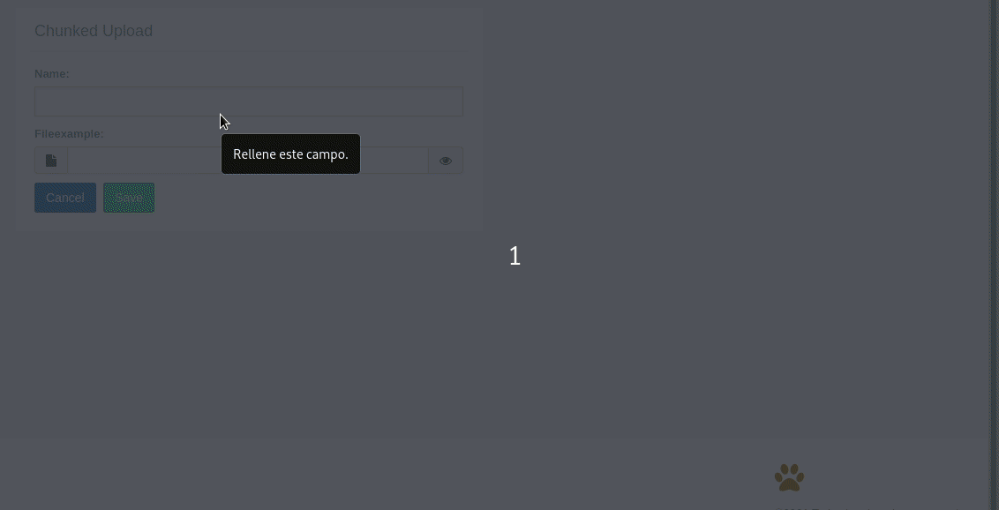

ChunkedUpload widget
^^^^^^^^^^^^^^^^^^^^



This widget approach used django-chunked-upload app for save the files to the respective directory.
You can add this widget only in a *FileField*.

The widget can be use in the Meta or in a field of the form.

In Meta class:

.. code:: python

    from djgentelella.widgets.core import TextInput
    from djgentelella.widgets.files import FileChunkedUpload
    from djgentelella.forms.forms import GTForm

    class ChunkedUploadItemForm(GTForm, forms.ModelForm):
        fileexample = forms.FileField(widget=FileChunkedUpload, required=False)
        class Meta:
            model = ChunkedUploadItem
            fields = '__all__'
            widgets = {
                'name': TextInput,
                'fileexample': FileChunkedUpload
            }

As a Form field:

.. code:: python

    from djgentelella.widgets.core import TextInput
    from djgentelella.widgets.files import FileChunkedUpload
    from djgentelella.forms.forms import GTForm

    class ChunkedUploadItemForm(GTForm, forms.ModelForm):
        fileexample = forms.FileField(widget=FileChunkedUpload, required=False)
        class Meta:
            model = ChunkedUploadItem
            fields = '__all__'

Make sure your model has the `fileexample` or the name of the field do you using to save file in your model.

**Whose upload is taken.** The browser uploads the file in chunks first and posts only a token, the
``upload_id`` of a ``ChunkedUpload``. ``FileChunkedUpload`` (and ``FileInput``)
turn that token into the file **whoever uploaded it, in whatever state**, and
delete the upload. That is on purpose: who attaches or deletes a document does
not have to be who uploaded it. The posted ``{"actions": "delete"}`` clears the
field, as before.

When the token must be the user's own, use ``UserFileChunkedUpload`` (or
``UserFileInput``): it takes the upload only if it belongs to its user and
finished (``status`` ``COMPLETE``). Any other token -- another user's, an
unfinished upload, or no user at all -- gives ``None`` and deletes nothing. It
uses the template and the javascript of ``FileChunkedUpload``
(``data-widget="FileChunkedUpload"``).

**Outside the form widgets the token is the user's own.** Code that sees the
request takes only a finished upload of who presents the token, through
``djgentelella.chunked_upload.utils.find_upload(token, user)``: a signed-in
user takes their own uploads, an anonymous visitor only the uploads without a
user, and an unfinished upload is never taken. That is the rule of

- ``ChunkedFileField`` and ``DigitalSignatureField`` (DRF), with the user of
  the request in the serializer's context; a serializer used without a
  request keeps taking the token whoever uploaded it (``ANY_USER``);
- the digital signature websocket (``SignConsumer`` passes the user of the
  socket to ``InstanceSerializer``);
- the document preview of the signature,
  ``DigitalSignatureRenderFileAPIView``, which answers 404 for another user's
  token, as for one of no upload.

``DigitalSignatureInput`` is a form widget and reads the token as the generic
widgets do, whoever uploaded it (only a finished upload).

A widget does not see the request, so the form gives it the user with
``UserBoundWidgetsMixin`` (called ``UserScopedUploadsMixin`` before 0.7.0; the
old name still works):

.. code:: python

    from djgentelella.forms.forms import GTForm, UserBoundWidgetsMixin
    from djgentelella.widgets.files import UserFileChunkedUpload

    class InvoiceForm(UserBoundWidgetsMixin, GTForm, forms.ModelForm):
        class Meta:
            model = Invoice
            fields = ['number', 'scan']
            widgets = {'scan': UserFileChunkedUpload}

    form = InvoiceForm(request.POST, user=request.user)   # or request=request

A form that already takes ``user`` for its own ends passes it on
(``super().__init__(*args, user=user, **kwargs)``) or keeps it as
``self.user``: when the mixin got no user, it takes ``self.user`` (or
``self.request.user``) before the form is cleaned. ``self.bind_upload_user(user)``
binds one explicitly, and reaches the subwidgets of a ``MultiWidget`` too.
Each form instance has its own copy of the widgets, so the user never leaks
between requests. The widget also takes it directly:
``UserFileChunkedUpload(user=request.user)``.

A form that keeps the upload for a later step (a data load that reads the file
after the user maps its columns) asks for the ``ChunkedUpload`` itself, which
is then not deleted:

.. code:: python

    file = forms.Field(widget=UserFileChunkedUpload(keep_upload=True))
    # cleaned_data['file'] is the ChunkedUpload of the user, or None

Two hooks make other policies a subclass away: ``get_upload(token)`` finds the
``ChunkedUpload`` (by token only in the generic widgets) and
``upload_value(upload)`` turns it into the field's value (its file, deleting
the upload). A wizard that keeps the upload for a later step overrides
``upload_value`` to return the upload itself.

The stored file is rendered as ``{"name", "display_name", "url"}`` JSON built
with ``json.dumps`` and escaped by the template, so a file name with quotes or
``</script>`` reaches the javascript intact. The javascript of
``FileChunkedUpload``, ``FileInput`` and ``PDFViewerWidget`` writes the name
with ``.text()``, so a name such as ```` (assigned by
code, or kept by a storage that does not clean names) is shown as text and
never becomes markup.

``PDFViewerWidget`` shows its document with PDF.js. Its viewer is kept as
``$('.pdfviewer-widget').data('pdfviewer')``; ``loadPDF(url)`` returns a
promise. Two calls for the same URL while it loads share that load (the
widget asks for its document twice as it starts, and two renders on one canvas
would clear each other); once it has settled, the same URL is fetched again,
so a file replaced on the server is shown anew.
